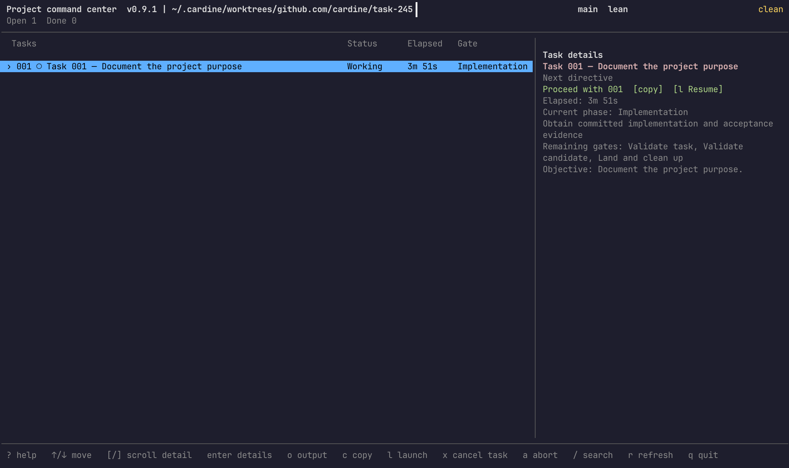

<p align="center">
  <picture>
    <source media="(prefers-color-scheme: dark)" srcset="docs/assets/cardine-mark-dark.svg">
    
  </picture>
</p>

<h1 align="center">Cardine</h1>

<p align="center"><strong>The delivery discipline for AI coding agents.</strong></p>

<p align="center">
  <a href="https://github.com/biagiolibe/cardine/releases/latest"></a>
  <a href="https://github.com/biagiolibe/cardine/actions/workflows/validate.yml"></a>
  
  <a href="LICENSE"></a>
</p>

> **Status: 0.10.0, before 1.0.** Install the CLI from the `v0.10.0` tag; see [Get started](#get-started).
> The scope of 1.0 is
> [docs/ADR_CARDINE_1_0.md](docs/ADR_CARDINE_1_0.md); what is proven today is
> listed under [Status and evidence](#status-and-evidence).

Coding agents can write the change. Nothing in the agent itself checks that
what reaches `main` was validated, integrated with the latest `main`, and can
be undone. Cardine does that part.

Every task lands on `main` validated, integrated, and reversible, or it stops
with a reason and the exact command to resume.

## What Cardine does

You describe one task in a short contract: objective, acceptance criteria,
the files it may change, validation commands, dependencies. Your agent then
calls one command,
`cardine run <TASK-ID>`, again and again. Each call performs the next step of
the task and prints JSON with the outcome and the exact command to run next.

Cardine runs locally, inside your Git repository, with no service and no
account. It works with Claude Code and Codex. It is not an agent and not an
orchestrator: it is the lifecycle your agent follows.

> Specs say what to build. Orchestrators run the agents. Cardine makes sure
> what lands on main is right.

Use it with the spec tool you already have.

## Works with your spec tool

Spec Kit, Kiro and BMAD turn an idea into requirements, a plan and tasks.
Write the tasks there, then register each one with `cardine task new`. Cardine
takes one task at a time and lands it with measured validation, CI, independent
review and integration, as configured for the task. An
[import is planned](docs/ADR_PRODUCT_DIRECTION.md#work-items).

| Tool | Structures | Enforced by | Lands on main |
| --- | --- | --- | --- |
| [Spec Kit](https://github.com/github/spec-kit) | Spec, plan, tasks | Convention in prompts | No |
| [Kiro](https://kiro.dev/) | Requirements, design, tasks | IDE workflow and hooks | No |
| [Superpowers](https://github.com/obra/superpowers) | Development workflow and skills | Agent skills | No |
| [Agent OS](https://buildermethods.com/agent-os) | Standards and specs | Instructions in agent context | No |
| [Cardine](https://github.com/biagiolibe/cardine) | Task delivery | CLI gates and measured evidence | Yes |

## How a task lands

`cardine run` moves a task through eight steps:

1. **Contract.** Check the task contract that `cardine task new` froze.
2. **Worktree.** Prepare one branch and one linked worktree for the task.
3. **Implementation.** The agent makes the change and commits it.
4. **Validation.** Cardine runs the task's validation commands itself.
5. **CI**, when `ciBeforeLanding` is set. Required checks pass on the delivered head before review.
6. **Review**, when required: a reviewer launched by `cardine run` with no write capability, or the developer’s own verdict.
7. **Candidate.** Validate `main` plus the task before merging.
8. **Landing.** Merge, push `main`, clean up the worktree and branch.

Every outcome falls into one of three classes:

| Class | Examples | What happens |
| --- | --- | --- |
| Guardrail | Merge conflict, rejected push, required review, scope change, denied action | The agent stops. Cardine prints `BLOCKED <CODE>` and the command a person runs to resume. |
| Recoverable state | Unfinished closure records, an interrupted cleanup, CI still running | The agent continues with the `next` command Cardine returns. |
| Failing work | Failing tests, a lint error | The agent fixes its work and validates again, up to a retry limit (3 by default). |

## Why it holds

**Stops are for people.** A stop is justified only when a person brings
something the agent lacks: authority, a decision, or information. Each stop
code in the registry declares whether it needs a person, and `cardine run`
refuses to print a stop for any code that does not. A failed validation run
is rerun once, so a test that fails intermittently does not consume the retry
limit. ([ADR decision 12](docs/ADR_CARDINE_1_0.md#12-stops-are-for-people))

**Gates read facts, not prose.** A gate reads only the task's state file
written by Cardine, Git objects, and the results of commands Cardine ran
itself. Handoffs and reports explain the work to people; no gate parses them.
An exit code that an agent reports is not evidence.
([decision 13](docs/ADR_CARDINE_1_0.md#13-gates-read-facts-not-prose))

**It holds with weak and strong agents.** An agent needs little to read: the
next action and a short contract. Rules whose violation causes harm are
enforced by a CLI gate, a hook, or a host permission rule, not only written
down. The files that gates trust are written by Cardine and bound to
operation receipts, so a file an agent writes on the task branch does not
change a gate's outcome. Host rules deny agents the state files and
developer-only commands, and an implementer cannot approve its own work.
Every step can be interrupted and rerun.
([decision 14](docs/ADR_CARDINE_1_0.md#14-robust-against-weak-and-strong-agents))

**One task, one worktree, one writer.** Agents never force-push, rewrite
history, create tags, delete unmerged branches, or resolve textual conflicts.
Those stay with you.

## Get started

Install Cardine on macOS or Linux with Python 3.12 or later, Git, and pipx:

```sh
pipx install git+https://github.com/biagiolibe/cardine@v0.10.0
```

Then, from your project checkout:

```sh
cardine init
cardine setup --check
cardine setup --apply
```

`init` configures the project and asks before it writes or publishes anything. `setup`
connects Claude Code or Codex. Then ask your agent: “I want to use Cardine here.” To
deliver a first task from the terminal, follow the [quick start](docs/QUICKSTART.md).
Run `cardine guide` at any time to see where the checkout stands and what to do next.

The console is optional: it shows task status and the next action in an interactive
terminal. See [the console](docs/QUICKSTART.md#project-console).



*Console development preview, commit `0132b8add339bc1e2808fd486201bf99a5ab37bb` (the displayed version is 0.9.1).*

## Lean or Governed

One lifecycle, two presets. A preset sets the project's defaults; each task
can raise or lower them.

| | `lean` (default) | `governed` |
| --- | --- | --- |
| Independent review | not required | required |
| `Authority` field | optional | required |
| `Expected code surface` field | needed by `cardine run` | required |
| Validation retry limit | 3 | 3 |

A `spike` task class for exploratory work, with an `ANSWERED` or
`INCONCLUSIVE` outcome, is available in both.

## When not to use Cardine

- Exploration and throwaway prototypes.
- A repository without a test command.
- Work that cannot be split into tasks of about ten files.

For a small change, a task record can set `Options: {"review": "not_required", "ciBeforeLanding": false}` for a quick path; see the [project declaration](docs/PROJECT_DECLARATION.md).

## What Cardine is not

- **Not an agent.** Your host (Claude Code or Codex) does the work.
- **Not an orchestrator.** It does not run several agents in parallel. An
  orchestrator can run Cardine inside each worktree.
- **Not a service.** Everything runs locally; `direct` landing needs no forge.
- **Not proof of authorship.** Agents run as your user. Receipts and host
  rules catch mistakes and refuse shortcuts, but an agent that deliberately
  bypasses the host's permissions could rewrite them. Cardine does not claim
  otherwise.
- **Not yet for team workflows.** [Pull request approvals as a review source](docs/ADR_REVIEW_VERDICT_SOURCES.md) and landing through pull requests are planned.

The project console, `cardine console`, is experimental.

## Status and evidence

Proven:

- in disposable test projects with a local bare remote: a task without
  review, from queued to landed on `main`; a task with required review and
  one round of requested changes; an agent that followed only what
  `cardine run` printed; a stop followed by a resume;
- the [quick start](docs/QUICKSTART.md) path for release 0.9.2, in a
  disposable home and project: installation with pipx from the `v0.9.2` tag,
  `cardine init`, `cardine setup` with the Claude Code plugin aligned to the
  release and the Codex skills linked, and a quick task from the terminal to
  landing on `main`;
- on Cardine's own repository: its tasks land through `cardine run`.

Not yet proven or measured:

- a task landed through Cardine in another project;
- the path where an agent installs Cardine and delivers the first task;
- the field trial that gates 1.0 (ADR decision 10);
- the comparison with and without Cardine. Its
  [protocol](docs/BENCHMARK_PROTOCOL.md) is decided; nothing has been run.
  Results will be published with the disclosure that the author of Cardine
  arbitrated disagreements, and they will state what they do not cover: the
  `lean` preset on a real adopter, Codex, and other models.

## Documentation

- **Using Cardine:** [quick start](docs/QUICKSTART.md),
  [run commands](docs/RUN_COMMANDS.md),
  [converting an existing project](docs/ADOPT_COMMANDS.md),
  [agent operations](docs/AGENT_OPERATIONS.md),
  [upgrade guide](docs/HOW_TO_UPGRADE.md),
  [platform support](docs/PLATFORM_SUPPORT.md).
- **Design:** [design decisions](docs/ADR_CARDINE_1_0.md),
  [public surface](docs/PUBLIC_SURFACE.md).
- **Contributing:** [contributing](CONTRIBUTING.md).

Tooling must read `--format json` output; human-readable output is never
stable.

## Origin and license

Cardine starts from the code of Meridian 1.4.0, which it replaces. Meridian's
history and design records stay in its
[repository](https://github.com/biagiolibe/meridian).

Follow the [code of conduct](CODE_OF_CONDUCT.md) and report vulnerabilities
through the [security policy](SECURITY.md).

Copyright © 2026 Biagio Liberto. Available under the [MIT License](LICENSE).
